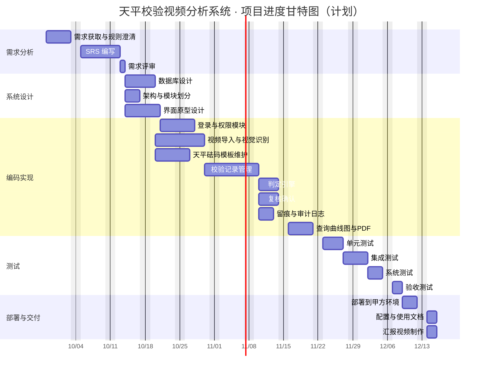

---
tags:
  - 天平校验视频分析项目
  - 管理文档
  - 进度管理
类型: 管理文档
知识领域: 进度管理
项目: 天平校验视频分析系统
组别: 第1组
状态: 草稿
---

# 软件项目进度计划（甘特图与网络图）

> 项目名称：天平校验视频分析系统　|　组别：第 1 组　|　编制日期：2026-10-01
> 依据：[[../范围管理/WBS工作分解结构]]、[[../成本管理/成本估算与预算]]
> 对应教材：[[第7章 软件项目进度计划]]

## 0. 编制说明

- **流程**（教材 §7.1）：任务定义 → 任务关系 → 历时估算 → 进度编排（CPM）→ 进度优化。
- **基准**：项目起始 **2026-09-28（周一）**，交付截止 **2026-12-19**；计划历时 **57 个工作日（约 11.4 周）**，计划完工日 **2026-12-16**，预留 3 天缓冲。
- **资源**：2 人组（第 1 组），按课余投入 ≈ 2.5 人时/天/人；总工作量 282 人时（见 [[../成本管理/成本估算与预算]]）。
- **历时口径**：以「工作日」计（周末不计），历时已考虑定额 T = Q/(R×S) 与人员有效工作时间。

---

## 1. 任务定义

把 WBS 的 25 个工作包进一步分解为**活动**（面向活动，教材 §7.2.1）。活动清单、历时与前置关系如下：

| 编号 | 活动 | 历时(工作日) | 前置任务 | 对应工作包 |
|---|---|---|---|---|
| A1 | 需求获取与业务规则澄清 | 5 | — | 1.1.1 |
| A2 | SRS 编写 | 6 | A1 | 1.1.2 |
| A3 | 需求评审 | 1 | A2 | 1.1.3 |
| B1 | 数据库设计 | 4 | A3 | 1.2.1 |
| B2 | 系统架构与模块划分 | 3 | A3 | 1.2.2 |
| B3 | 界面原型设计（7 张） | 5 | A3 | 1.2.3 |
| C1 | 登录与权限模块 | 5 | B2, B3 | 1.3.1 |
| C2 | 视频导入与视觉识别 | 8 | B1, B2 | 1.3.2 |
| C3 | 校验记录管理 | 7 | C1, C2, B3 | 1.3.3 |
| C4 | 校验判定引擎 | 4 | C3 | 1.3.5 |
| C5 | 复核确认模块 | 4 | C3 | 1.3.4 |
| C6 | 查询/曲线图/PDF 导出 | 5 | C3, C4 | 1.3.6 |
| C7 | 天平/砝码/模板维护 | 5 | B1 | 1.3.7 |
| C8 | 留痕与审计日志 | 3 | C3 | 1.3.8 |
| D1 | 单元测试 | 4 | C4, C5, C6, C7, C8 | 1.4.1 |
| D2 | 集成测试 | 3 | D1 | 1.4.2 |
| D3 | 系统测试（3 个视频） | 3 | D2 | 1.4.3 |
| D4 | 验收测试 | 2 | D3 | 1.4.4 |
| E1 | 部署到甲方环境 | 3 | D4 | 1.5.1 |
| E2 | 配置与使用说明文档 | 2 | E1 | 1.5.2 |
| E3 | 汇报视频制作 | 2 | E1 | 1.5.3 |
| P | 项目管理（进度/风险/沟通/配置/质量，贯穿） | 全程 | — | 1.6.x |

## 2. 任务关系与网络图

### 2.1 任务关系

- **强制性依赖**（硬逻辑）：A→B（需求→设计）、C→D（编码→测试）、D→E（测试→交付）不可违背。
- **选择性依赖**：C1 与 C2 的先后、C4/C5/C6 的并行编排，按 2 人组能力人为确定。
- **超前（lead）**：设计未全部完成即启动部分编码（快速跟进），如 C2 在 B1 完成后即可开始（FS-? 的提前量），以压缩总工期。

### 2.2 PDM 网络图（单代号，示意）

```
        ┌── B1(4) ────────────┐
        │                      ├── C2(8) ──┐
A1(5)→A2(6)→A3(1)┤── B2(3) ──┼── C1(5) ──┤
        │                      │           ├→ C3(7) ─┬→ C4(4)─┬→ C6(5) ─┐
        └── B3(5) ────────────┘           │          ├→ C5(4)─┤         │
                                          │          └→ C8(3)─┤         │
                            B1→ C7(5) ─────────────────────────┤         │
                                                               └→ D1(4)→D2(3)→D3(3)→D4(2)→E1(3)→E2(2)
                                                                                                 └→E3(2)
```

> 关键路径节点用 ★ 标注，见 §3.3。

## 3. 历时估算与关键路径法（CPM）

### 3.1 历时估算方法

- **定额法**（教材 §7.4.1）T = Q / (R × S)：如 C2 视频识别工作量约 24 人时、2 人投入、有效效率 0.9 → T ≈ 24/(2×0.9×8) ≈ 1.7 工作日，余量并入识别的联调。
- **三点估算 / PERT**（教材 §7.4.3）用于高不确定活动（如 C2 视觉识别）：

| 活动 | 最乐观 O | 最可能 M | 最悲观 P | PERT (O+4M+P)/6 | 标准差 (P−O)/6 |
|---|---|---|---|---|---|
| C2 视频导入与视觉识别 | 5 | 8 | 14 | 8.17 | 1.5 |
| C3 校验记录管理 | 5 | 7 | 10 | 7.17 | 0.83 |

> C2 标准差最大（1.5），是进度风险最集中的活动，已纳入风险清单。

### 3.2 正推 / 逆推（时间单位为「工作日序」，起始 = day 0）

| 编号 | 活动 | 历时 | ES | EF | LS | LF | 总浮动 TF | 关键? |
|---|---|---|---|---|---|---|---|---|
| A1 | 需求获取与澄清 | 5 | 0 | 5 | 0 | 5 | 0 | ★ |
| A2 | SRS 编写 | 6 | 5 | 11 | 5 | 11 | 0 | ★ |
| A3 | 需求评审 | 1 | 11 | 12 | 11 | 12 | 0 | ★ |
| B1 | 数据库设计 | 4 | 12 | 16 | 12 | 16 | 0 | ★ |
| B2 | 架构与模块划分 | 3 | 12 | 15 | 13 | 16 | 1 | |
| B3 | 界面原型设计 | 5 | 12 | 17 | 14 | 19 | 2 | |
| C1 | 登录与权限模块 | 5 | 17 | 22 | 19 | 24 | 2 | |
| C2 | 视频导入与视觉识别 | 8 | 16 | 24 | 16 | 24 | 0 | ★ |
| C3 | 校验记录管理 | 7 | 24 | 31 | 24 | 31 | 0 | ★ |
| C4 | 校验判定引擎 | 4 | 31 | 35 | 31 | 35 | 0 | ★ |
| C5 | 复核确认模块 | 4 | 31 | 35 | 36 | 40 | 5 | |
| C6 | 查询/曲线图/PDF | 5 | 35 | 40 | 35 | 40 | 0 | ★ |
| C7 | 天平/砝码/模板维护 | 5 | 16 | 21 | 35 | 40 | 19 | |
| C8 | 留痕与审计日志 | 3 | 31 | 34 | 37 | 40 | 6 | |
| D1 | 单元测试 | 4 | 40 | 44 | 40 | 44 | 0 | ★ |
| D2 | 集成测试 | 3 | 44 | 47 | 44 | 47 | 0 | ★ |
| D3 | 系统测试 | 3 | 47 | 50 | 47 | 50 | 0 | ★ |
| D4 | 验收测试 | 2 | 50 | 52 | 50 | 52 | 0 | ★ |
| E1 | 部署到甲方环境 | 3 | 52 | 55 | 52 | 55 | 0 | ★ |
| E2 | 配置与使用说明文档 | 2 | 55 | 57 | 55 | 57 | 0 | ★ |
| E3 | 汇报视频制作 | 2 | 55 | 57 | 55 | 57 | 0 | ★ |

### 3.3 关键路径

**关键路径**（浮动为 0 且最长）：

```
A1 → A2 → A3 → B1 → C2 → C3 → C4 → C6 → D1 → D2 → D3 → D4 → E1 → E2/E3
```

- 关键路径长度 = **57 个工作日**（= 项目最短完成时间）。
- 关键活动：A1、A2、A3、B1、C2、C3、C4、C6、D1、D2、D3、D4、E1、E2、E3。
- **浮动最大的非关键活动**：C7（TF=19）、C8（TF=6）、C5（TF=5）——可作为资源调配与缓冲来源。
- **监控重点**：C2（视频识别，标准差 1.5）在关键路径上且不确定性最高，是进度风险首要监控对象。

## 4. 甘特图



## 5. 里程碑计划

| 里程碑 | 标志性事件 | 计划日期 | 对应关键活动 |
|---|---|---|---|
| M1 | 需求评审通过 | 2026-10-14 | A3 |
| M2 | 设计完成（数据库+架构+原型） | 2026-10-21 | B3 |
| M3 | 编码完成 | 2026-11-23 | C6 |
| M4 | 测试完成（系统/验收测试通过） | 2026-12-09 | D4 |
| M5 | 部署完成（甲方环境可运行） | 2026-12-14 | E1 |
| M6 | 交付完成（文档+汇报视频） | 2026-12-16 | E2/E3 |
| M7 | 提交截止（上传百度网盘） | 2026-12-19 | — |
| M8 | 协助甲方部署完成（课程窗口） | 2026-12-24 | — |
| M9 | 客户评分完成 | 2026-12-26 | — |

> 里程碑一旦确定**不轻易改变**（教材 §7.2.4）；进度管理的本质就是确保里程碑达成。

## 6. 进度优化

- **时间压缩**：对关键路径上的 C2/C3 采用**快速跟进**（设计未完成即开始编码，见 §2.1 超前）；必要时用**应急法**增加投入赶工。
- **资源优化**：2 人组资源有限，对非关键活动 C5/C7/C8（浮动 5~19 天）做**资源平滑**，错峰投入，避免与关键活动争抢人力（不改变关键路径）。
- **缓冲设置**（教材 §7.4.8）：将各活动安全时间集中放于**关键路径末端**作为项目缓冲（PB）。计划完工 12/16、截止 12/19，**项目缓冲 ≈ 3 天**。
- **警惕帕金森定律**：不为每项任务虚加工时，缓冲统一留在项目末端。

## 7. 进度跟踪与变更

- **跟踪依据**：以本计划的关键路径与里程碑为基准，在 [[第13章 项目跟踪与度量]] 中按周记录实际进度，计算 SV/CV。
- **燃尽图**：项目执行中每日更新剩余工作量（教材 §7.2.6），直观反映开发速度。
- **变更联动**：需求/WBS 变更须同步评估对关键路径的影响；必要时重排进度并更新里程碑。
- **跟踪载体**：进度跟踪记录见「进度管理 / 进度跟踪记录」（待补）。

## 关联

- 依据：[[../范围管理/WBS工作分解结构]]、[[../成本管理/成本估算与预算]]
- 索引：[[../管理文档索引]]
- 教材：[[第7章 软件项目进度计划]]、[[第13章 项目跟踪与度量]]
