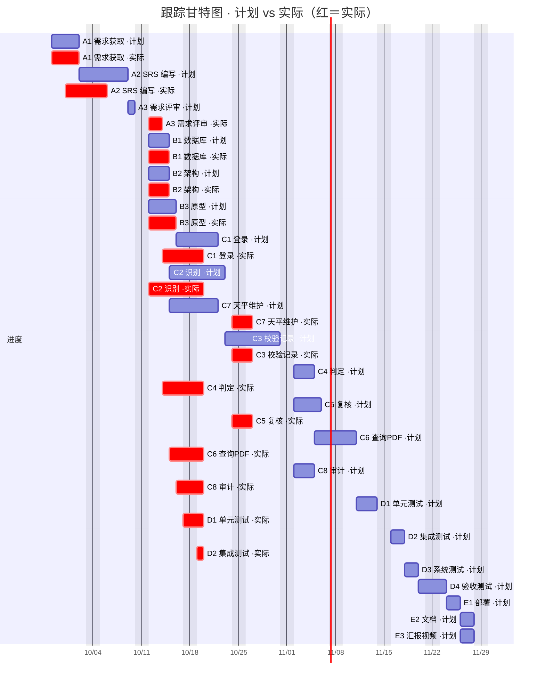

---
tags:
  - 天平校验视频分析项目
  - 管理文档
  - 进度管理
类型: 跟踪记录
知识领域: 进度管理
项目: 天平校验视频分析系统
组别: 第1组
状态: 进行中
---

# 进度跟踪记录

> 项目名称：天平校验视频分析系统　|　组别：第 1 组
> 基准：[[进度计划（甘特图与网络图）]]
> 对应教材：[[第7章 软件项目进度计划]]、[[第13章 项目跟踪与度量]]

## 1. 跟踪说明

- **依据**：以进度计划的关键路径与里程碑为基准，按**每周**跟踪实际进展，计算进度偏差。
- **指标**：计划完成率 / 实际完成率 / 进度偏差 SV = EV − PV；燃尽图反映剩余工作量。
- **更新时点**：每周例会后更新本记录。

## 2. 里程碑跟踪表

| 里程碑 | 标志事件 | 计划日期 | 实际日期 | 状态 |
|---|---|---|---|---|
| M1 | 需求评审通过 | 2026-10-12 | 2026-10-14 | 已完成 |
| M2 | 设计完成 | 2026-10-16 | 2026-10-19 | 已完成 |
| M3 | 编码完成 | 2026-11-11 | 2026-10-24 | 已完成 |
| M4 | 测试完成 | 2026-11-24 | — | 未开始 |
| M5 | 部署完成 | 2026-11-26 | — | 未开始 |
| M6 | 交付完成 | 2026-11-27 | — | 未开始 |
| M7 | 提交截止 | 2026-11-29 | — | 未开始 |

> M2 实际日期按甲模块交付与测试记录（10-19）推定，最终以评审确认日期为准。

## 3. 周跟踪记录

| 周次 | 日期区间 | 计划完成 | 实际完成 | 完成率 | 偏差 | 措施 |
|---|---|---|---|---|---|---|
| W1 | 09/26–10/02 | A1 需求获取与澄清 | 需求规则已逐条澄清，SRS V1.0 定稿 | 100% | 0 | — |
| W2 | 10/05–10/11 | A2 SRS 编写 | SRS 定稿（含 7 原型图） | 100% | 0 | — |
| W3 | 10/12–10/18 | A3 需求评审（M1） | 需求评审通过（M1），设计启动 | 100% | 0 | — |
| W4 | 10/19–10/25 | B1/B2/B3 设计 + 甲乙模块编码 | 甲乙模块（识别/判定/查询导出/审计 + 账号/记录/复核/主数据）编码完成，64 条测试全绿 | 100% | 领先 | 三视频全流程验收待开展 |
| … | … | … | … | … | … | … |

> W1–W3 需求分析按计划完成；SRS 已定稿并建立基线（见 [[../范围管理/需求变更记录]] CR-001/CR-002/CR-003）。W4 起进入设计/编码，甲负责模块（识别/判定/查询导出/审计）与乙负责模块（C1 账号维护、C3 校验记录管理、C5 复核确认、C7 主数据维护）均已编码完成并通过测试，较计划提前。code-review 后补齐作废入口、天平双量程编辑、砝码盒 CRUD，全量 70 tests, 0 failures。剩余三视频全流程验收（D3 系统测试）待开展。

## 4. 进度对比（计划 vs 实际）

### 4.1 计划 vs 实际进度对比表

> 状态：✅ 已完成　🟡 部分完成/进行中　⬜ 未开始

| 活动 | 计划起止 | 实际进度 | 状态 |
|---|---|---|---|
| A1 需求获取与澄清 | 09-28 ~ 10-02 | 已完成 | ✅ |
| A2 SRS 编写 | 10-02 ~ 10-09 | V1.0 定稿（10-01） | ✅ |
| A3 需求评审 | 10-09 ~ 10-12 | 已完成（M1 通过） | ✅ |
| B1 数据库设计 | 10-12 ~ 10-15 | 已完成 | ✅ |
| B2 架构与模块划分 | 10-12 ~ 10-15 | 已完成 | ✅ |
| B3 界面原型设计 | 10-12 ~ 10-16 | 已完成 | ✅ |
| C1 登录与权限 | 10-16 ~ 10-22 | 登录/拦截器 + 账号增删/重置完成（乙） | ✅ |
| C2 视频识别 | 10-15 ~ 10-23 | 已完成（甲） | ✅ |
| C7 天平/砝码维护 | 10-15 ~ 10-22 | 天平 CRUD 完成（乙） | ✅ |
| C3 校验记录管理 | 10-23 ~ 11-02 | 落库/改值留痕/提交/作废完成（乙） | ✅ |
| C4 判定引擎 | 11-02 ~ 11-05 | 已完成（甲，提前约 2 周） | ✅ |
| C5 复核确认 | 11-02 ~ 11-06 | 确认/打回/批量完成（乙） | ✅ |
| C6 查询/PDF | 11-05 ~ 11-11 | 已完成（甲，提前约 2 周） | ✅ |
| C8 审计 | 11-02 ~ 11-05 | 已完成（甲，提前约 2 周） | ✅ |
| D1 单元测试 | 11-11 ~ 11-16 | 甲范围完成（10-19） | 🟡 |
| D2 集成测试 | 11-16 ~ 11-18 | 甲链路贯通（10-19） | 🟡 |
| D3 系统测试 | 11-18 ~ 11-20 | 部分通过（DEF-001 示值 OCR） | 🟡 |
| D4 验收测试 | 11-20 ~ 11-24 | 未开始 | ⬜ |
| E1 部署 | 11-24 ~ 11-26 | 未开始 | ⬜ |
| E2 文档 | 11-26 ~ 11-27 | 未开始 | ⬜ |
| E3 汇报视频 | 11-26 ~ 11-27 | 未开始 | ⬜ |

> 对比小结：甲乙负责的编码活动（C1~C8）均已**提前约 2~3 周**完成，需求/设计按计划推进，整体 SV > 0（领先）。乙负责的 C1 账号维护、C3 校验记录管理、C5 复核确认、C7 主数据维护已完成并通过测试（全量 70 测试通过）。剩余风险转移到 **D3 系统测试（三视频全流程验收）** 与后续部署。

### 4.2 跟踪甘特图



> 图例：默认色＝计划；红色（`crit`）＝实际。每个活动的「计划」条与「实际」条上下并排，便于逐项对比。未开始的活动（D3/D4、E1–E3）只有计划条。乙模块 C1/C3/C5/C7 已于 10-24 完成并补画实际条。
> 说明：甲乙范围 D1/D2 测试均已通过（全量 64 tests, 0 failures），编码依赖已闭合；D3 系统测试（三视频全流程验收）待开展。

## 5. 燃尽图

```
剩余工作量(人时)
282 ┤●
    │  ●
    │     ●
    │        ╲
    │          ╲__
    │             ╲____  ← 实际（每周更新）
    │  ·  ·  ·  ·  ·  ·← 理想燃尽线
  0 ┤────────────────────→ 周
    W1 W3 W5 W7 W9
```

> 实际线应贴近或低于理想线；高于理想线说明滞后，需分析原因（教材 §7.2.6）。

## 6. 关联

- [[../管理文档索引]]
- 基准计划：[[进度计划（甘特图与网络图）]]
- 成本跟踪：[[../成本管理/实际成本记录]]
