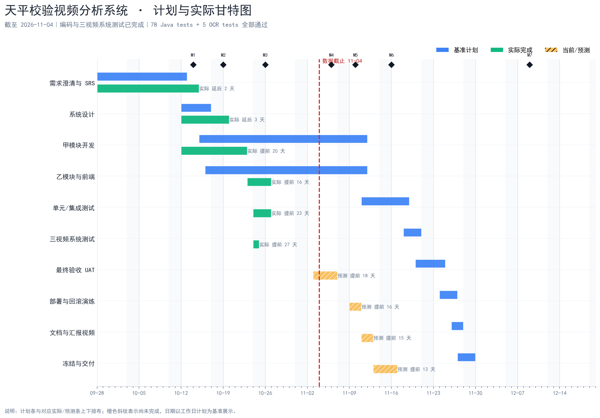
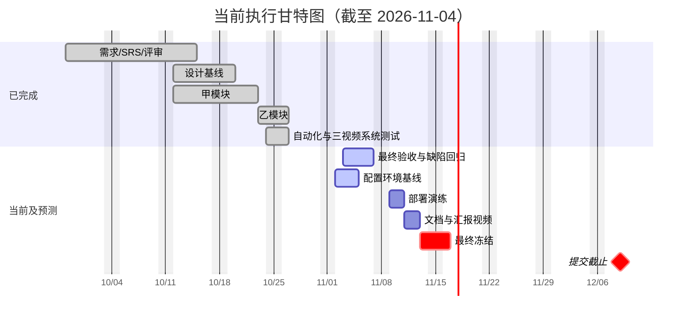

---
tags:
  - 天平校验视频分析项目
  - 管理文档
  - 进度管理
类型: 跟踪记录
知识领域: 进度管理
项目: 天平校验视频分析系统
组别: 第1组
状态: 进行中（截至 2026-11-04）
---

# 进度跟踪记录

> 项目名称：天平校验视频分析系统　|　组别：第 1 组
> 基准：[[进度计划（甘特图与网络图）]]
> 对应教材：[[第7章 软件项目进度计划]]、[[第13章 项目跟踪与度量]]

## 1. 跟踪说明

- **依据**：以进度计划的关键路径与里程碑为基准，按**每周**跟踪实际进展，计算进度偏差。
- **指标**：计划完成率 / 实际完成率 / 进度偏差 SV = EV − PV；燃尽图反映剩余工作量。
- **更新时点**：每周例会后更新本记录。

## 2. 里程碑跟踪表

| 里程碑 | 标志事件 | 计划日期 | 实际日期 | 状态 |
|---|---|---|---|---|
| M1 | 需求评审通过 | 2026-10-12 | 2026-10-14 | 已完成 |
| M2 | 设计完成 | 2026-10-16 | 2026-10-19 | 已完成 |
| M3 | 编码完成 | 2026-11-11 | 2026-10-26 | 已完成 |
| M4 | 测试完成 | 2026-11-24 | 预测 2026-11-06 | 进行中（待最终验收） |
| M5 | 部署完成 | 2026-11-26 | 预测 2026-11-10 | 未开始 |
| M6 | 交付完成 | 2026-11-27 | 预测 2026-11-16 | 未开始 |
| M7 | 提交截止 | 2026-12-09 | — | 未开始 |

> M2 实际日期按甲模块交付与测试记录（10-19）推定，最终以评审确认日期为准。

## 3. 周跟踪记录

| 周次 | 日期区间 | 计划完成 | 实际完成 | 完成率 | 偏差 | 措施 |
|---|---|---|---|---|---|---|
| W1 | 09/26–10/02 | A1 需求获取与澄清 | 需求规则已逐条澄清，SRS V1.0 定稿 | 100% | 0 | — |
| W2 | 10/05–10/11 | A2 SRS 编写 | SRS 定稿（含 7 原型图） | 100% | 0 | — |
| W3 | 10/12–10/18 | A3 需求评审（M1） | 需求评审通过（M1），设计启动 | 100% | 0 | — |
| W4 | 10/19–10/25 | B1/B2/B3 设计 + 甲乙模块编码 | 甲乙模块编码完成，补账号/砝码盒/模板编辑，三视频全流程验收完成 | 100% | 领先 | 进入缺陷回归与文档阶段 |
| W5 | 10/26–11/01 | D1/D2/D3 测试与前端优化 | 前端/入口优化完成；Java 78 项测试、本地 OCR 5 项测试全绿 | 100% | 领先 | 启动部署环境与最终验收准备 |
| W6 | 11/02–11/08 | D4 验收准备 | 环境基线、风险复盘、甘特图修订进行中 | 进行中 | 基本符合 | 11/06 前关闭验收问题 |
| W7 | 11/09–11/15 | E1/E2/E3 | 计划：部署演练、文档定稿、汇报视频 | 0% | 待开始 | 保留 11/16 后缓冲 |

> W1–W3 需求分析按计划完成；SRS 已定稿并建立基线（见 [[../范围管理/需求变更记录]] CR-001/CR-002/CR-003）。W4 起进入设计/编码，甲负责模块（识别/判定/查询导出/审计）与乙负责模块（C1 账号维护、C3 校验记录管理、C5 复核确认、C7 主数据维护）均已完成。code-review 后补齐作废入口、事务控制、天平一致性校验、示值完整性校验、主数据维护和前端入口优化。全量 **78 Java tests + 5 OCR tests** 通过。三视频系统测试（D3）已完成：video1 身份不匹配阻断、video2/video3 走通「提交→复核→查询/曲线/PDF」。

## 4. 进度对比（计划 vs 实际）

### 4.1 计划 vs 实际进度对比表

> 状态：✅ 已完成　🟡 部分完成/进行中　⬜ 未开始

| 活动 | 计划起止 | 实际进度 | 状态 |
|---|---|---|---|
| A1 需求获取与澄清 | 09-28 ~ 10-02 | 已完成 | ✅ |
| A2 SRS 编写 | 10-02 ~ 10-09 | V1.0 定稿（10-01） | ✅ |
| A3 需求评审 | 10-09 ~ 10-12 | 已完成（M1 通过） | ✅ |
| B1 数据库设计 | 10-12 ~ 10-15 | 已完成 | ✅ |
| B2 架构与模块划分 | 10-12 ~ 10-15 | 已完成 | ✅ |
| B3 界面原型设计 | 10-12 ~ 10-16 | 已完成 | ✅ |
| C1 登录与权限 | 10-16 ~ 10-22 | 登录/拦截器 + 账号增删/编辑/重置完成（乙） | ✅ |
| C2 视频识别 | 10-15 ~ 10-23 | 已完成（甲） | ✅ |
| C7 天平/砝码维护 | 10-15 ~ 10-22 | 天平/砝码盒/模板 CRUD 完成（乙） | ✅ |
| C3 校验记录管理 | 10-23 ~ 11-02 | 落库/改值留痕/提交/作废完成（乙，10-26） | ✅ |
| C4 判定引擎 | 11-02 ~ 11-05 | 已完成（甲，提前约 2 周） | ✅ |
| C5 复核确认 | 11-02 ~ 11-06 | 确认/打回/批量完成（乙） | ✅ |
| C6 查询/PDF | 11-05 ~ 11-11 | 已完成（甲，提前约 2 周） | ✅ |
| C8 审计 | 11-02 ~ 11-05 | 已完成（甲，提前约 2 周） | ✅ |
| D1 单元测试 | 11-11 ~ 11-16 | 78 Java tests + 5 OCR tests 全绿（提前） | ✅ |
| D2 集成测试 | 11-16 ~ 11-18 | 甲乙链路贯通（提前） | ✅ |
| D3 系统测试 | 11-18 ~ 11-20 | 三视频全流程系统测试完成（10-24，提前） | ✅ |
| D4 验收测试 | 11-20 ~ 11-24 | 计划 11-03 启动，预测 11-06 完成 | 🟡 |
| E1 部署 | 11-24 ~ 11-26 | 计划 11-09 启动 | ⬜ |
| E2 文档 | 11-26 ~ 11-27 | 配置环境与使用文档编写中 | 🟡 |
| E3 汇报视频 | 11-26 ~ 11-27 | 未开始 | ⬜ |

> 对比小结：甲乙负责的编码活动（C1~C8）和 D1~D3 已完成，整体 SV > 0（领先）。当前重点是 D4 最终验收、部署演练、环境/使用文档和汇报材料。编码提前不改变 12/9 课程硬截止，剩余时间作为缺陷修复、部署和演示缓冲。

### 4.2 当前执行甘特图





> 完整计划/实际/预测双视角见 [[进度计划（甘特图与网络图）#4.1 执行版甘特图（截至 2026-11-04）]]。本节仅保留当前跟踪视图，避免复制后出现测试数量不一致。

## 5. 燃尽图

```
剩余工作量(人时)
282 ┤●
    │  ●
    │     ●
    │        ╲
    │          ╲__
    │             ╲____  ← 实际（每周更新）
    │  ·  ·  ·  ·  ·  ·← 理想燃尽线
  0 ┤────────────────────→ 周
    W1 W3 W5 W7 W9
```

> 实际线应贴近或低于理想线；高于理想线说明滞后，需分析原因（教材 §7.2.6）。

## 6. 关联

- [[../管理文档索引]]
- 基准计划：[[进度计划（甘特图与网络图）]]
- 成本跟踪：[[../成本管理/实际成本记录]]
